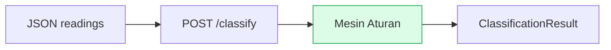

# 01 — Gambaran Umum

Layanan Klasifikasi Gangguan Pompa memantau kondisi pompa (penggerak/VSD dan panel) dari data sensor file CSV, lalu menentukan kondisi operasi: salah satu jenis gangguan, atau `normal` (sehat).

## Tujuan

- Mengubah data sensor mentah menjadi keputusan operasional yang bisa ditindaklanjuti.
- Menjaga konsistensi penilaian file dokumen (unggah → siapkan → pindai).
- Memisahkan tugas secara tegas: penerimaan data, pengurutan waktu, penilaian gangguan, dan tampilan hasil.

## Prinsip Utama

- **Satu aturan untuk semua jalur.** Setiap pembacaan terakhir dinilai apa adanya: cocok dengan pola gangguan atau tidak. Tidak ada status “dilewati” — bila datanya ada, dinilai; bila datanya hilang, dicatat sebagai keterangan dan gangguan dianggap **tidak terdeteksi**.
- **Waktu kejadian mengikuti data.** Waktu yang dipakai adalah waktu yang tercatat pada data sensor itu sendiri, bukan waktu sistem menerimanya.
- **Data kosong tidak diisi nol.** Sensor yang tidak mengirim dibiarkan kosong dan dilaporkan sebagai data hilang; tidak pernah diganti angka `0`.
- **Pompa tersangkut sampah langsung diputuskan** begitu polanya terpenuhi (frekuensi ≤ 10 Hz dan minimal 3 dari 4 tanda lain) — tanpa menunggu bukti berulang.
- **Satu jalur penilaian:** API langsung `POST /classify` — stateless, tanpa CSV, untuk tim BE (mesin sama). Lihat `18` dan `19`.
  - Catatan (refactor 2026-10-19): jalur file/CSV (unggah → normalisasi → kelompok) **dihapus** dari backend ini; migrasi Node.js dibahas di `20`.

## Konteks Sistem

## Jenis Gangguan

Ada sembilan hasil penilaian, dengan `normal` sebagai kondisi sehat bila tidak ada pola gangguan yang cocok:

- `pompa_tersangkut_sampah` — pompa diduga tersangkut sampah
- `turbulensi` — aliran tidak stabil
- `banyak_sampah` — beban sampah tinggi pada keempat indikator
- `unbalance` — arus tiga fasa tidak seimbang (satu fasa menyimpang 10% atau lebih sudah cukup)
- `undervoltage` — tegangan di bawah 360 V
- `overvoltage` — tegangan di atas 410 V
- `dry_run` — pompa berjalan tanpa beban air (dulu bernama `low_water_menyala`)
- `panel_overheat` — suhu panel 60 °C atau lebih
- `normal` — tidak ada gangguan terdeteksi

## Status Evaluasi

Setiap hasil penilaian membawa status kelengkapan data:

- **Data lengkap** — semua penilaian bisa dijalankan.
- **Data tidak cukup** — tidak ada penilaian yang bisa dijalankan sama sekali.

Setiap jenis gangguan dinilai satu per satu: **terdeteksi** atau **tidak terdeteksi**. Bila datanya hilang, hasilnya **tidak terdeteksi** disertai catatan keterangan — tidak ada status “dilewati”.
