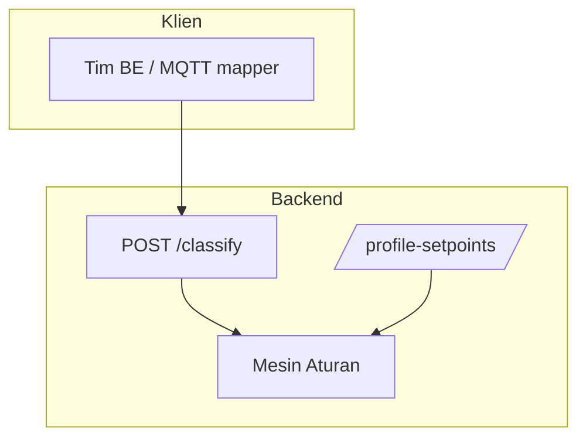

# 02 — Susunan Sistem

> Refactor 2026-10-19: backend Python dirampingkan menjadi **engine + API stateless**.
> Pipeline CSV/storage, CLI, dan DB ingest Python dihapus.
> Cutover 2026-10-20: implementasi berpindah ke **Node.js (TypeScript + Socket.IO)**;
> kode Python dihapus, perilakunya dibekukan sebagai fixture golden + differential.
> Detail migrasi: `20`.

## Struktur Program Backend

```
backend-node/src/
  server.ts                 # Titik masuk layanan web (Socket.IO)
  middleware/apiKey.ts      # Gerbang X-API-Key (exact-match exempt + timing-safe)
  api/
    classify.ts             # POST /classify (kontrak stabil)
    profileSetpoints.ts     # Baca/ubah acuan tiap pompa (merge semantics)
  engine/
    engine.ts               # Aturan penilaian (orkestrator)
    support.ts              # T_A MA30/CMA_n, freq_eq_2dp, helper
    evaluator.ts            # 8 aturan + panel/unbalance/voltage
    evidence.ts             # Trailing 31 pasca-gap
    models.ts               # Bentuk data masuk & keluar
    profiles.ts             # Kapasitas per profil
    setpoints.ts            # override > profil
    configuration-resolver.ts
    service.ts              # Factory getEngine()
    rules.json              # Batas tiap ukuran pompa + aturan tegangan
    pump_profiles.json      # Profil 500 / 3000 / 5000 lps
    profile_setpoints.json# Frekuensi / kecepatan / torsi per profil
  util/                     # format Python, timestamp ber-zona, JSON
```

## Struktur Tampilan — landing statis

> 2026-10-21: aplikasi Next.js dan direktori `frontend/` dihapus. Hostname publik
> `classify.aldozeno.my.id` hanya dilayani **landing statis** (`landing/serve.mjs`).

```
landing/
  index.html              # Halaman publik: lembar diagnosis + kontrak API
  styles.css · app.js     # Tampilan, pemilih kasus, widget status
  build-data.mjs          # Generate data.json dari rules + golden suite
  data.json               # 9 contoh diagnosis + 8 aturan (generated)
  build-rules.mjs         # Generate aturan.html semua tier + contoh (butuh deps backend)
  aturan.template.html    # Kerangka halaman aturan
  aturan.html             # Aturan & contoh 500/3000/5000 lps (generated)
  serve.mjs               # Static server stdlib (:3030)
```

> `/aturan` menyajikan aturan mentah dan contoh 500/3000/5000 lps; CI menjaga
> `aturan.html` tetap sinkron lewat `node build-rules.mjs --check`.
>
> Endpoint lama `/documents`, `/normalization`, `/telemetry`, `/classification/*`
> sudah dihapus.

## Struktur Schema DB — kontrak arsitektur

```
App/service/schema/
  dexmin/dexmin.sql       # DDL kanonis: 7 tabel, MySQL 8.x, utf8mb4_unicode_ci
```

`dexmin.sql` adalah satu-satunya sumber DDL. Backend Node belum membuka koneksi
MySQL; schema dipertahankan sebagai kontrak untuk tahap ingestion berikutnya
(lihat `07-storage.md` dan `20-migrasi-nodejs.md`).

## Modul & Tanggung Jawab

| Modul | Peran | Batasan |
|-------|-------|---------|
| `classification` | Data → hasil (pembacaan terakhir; data hilang = tidak terdeteksi + catatan) | Tidak tahu tampilan/disk/DB |
| `api/classify` | Penghubung web single-shot | Tidak mengandung logika aturan |
| `api/profile_setpoints` | Baca/ubah acuan profil | Tidak mengandung logika aturan |
| `service.ts` | Factory `getEngine()` | Tanpa CSV/FS/MySQL; tanpa duplikasi rumus |

## Diagram Komponen



Keterangan sederhana: JSON readings → aturan penilaian → jawaban JSON.
