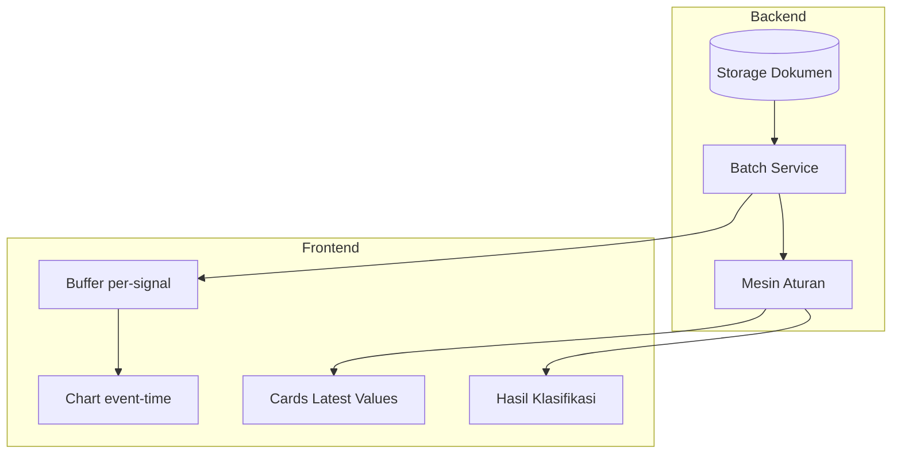

# 02 — Susunan Sistem

## Struktur Program Backend

```
backend/app/
  main.py                 # Titik masuk layanan web
  api/
    documents.py          # Unggah & kelola file
    normalization.py      # Penyeragaman kolom file
    telemetry.py          # Data siap nilai
    classification.py     # Penilaian gangguan
    profile_setpoints.py  # Ubah acuan tiap pompa
  classification/
    engine.py             # Aturan penilaian
    models.py             # Bentuk data masuk & keluar
    rules.json            # Batas tiap ukuran pompa + aturan tegangan
    pump_profiles.json    # Profil 500 / 3000 / 5000 lps
    profile_setpoints.json# Frekuensi / kecepatan / torsi per profil
    service.py            # Jembatan file → penilaian (potongan waktu, pemindaian)
  data_pipeline/
    models.py             # Bentuk dokumen mentah & data siap nilai
    document_loader.py    # Baca file CSV
    document_storage.py   # Simpan file di disk
    normalization.py      # Petakan kolom → nama baku
    service.py            # Alur unggah → seragam → siap nilai
```

## Struktur Tampilan (Frontend)

```
frontend/src/app/
  api.ts                  # Panggil layanan (/api/*)
  replay.ts               # 16 sinyal file, tampung, gambar
  page.tsx                # Alih → /documents
  documents/page.tsx      # Penilaian kelompok + pindai + grafik file
  chat/page.tsx           # Chat asisten Dexmin (SSE)
  admin/page.tsx          # Ubah acuan tiap profil
```

## Modul & Tanggung Jawab

| Modul | Peran | Batasan |
|-------|-------|---------|
| `data_pipeline` | File → data siap nilai 16 kolom, kosong tanpa diisi nol | Tidak tahu penilaian |
| Aturan penilaian | Data → hasil (pembacaan terakhir; data hilang = tidak terdeteksi + catatan; pompa tersangkut sampah langsung diputuskan) | Tidak tahu tampilan/disk |
| `api/*` | Penghubung web | Tidak mengandung logika aturan |
| `replay.ts` | Gambar per sinyal (grafik dokumen) | Tidak tahu broker |

## Diagram Komponen



Keterangan sederhana: file (kelompok & pindai) → aturan penilaian → tampilan.
