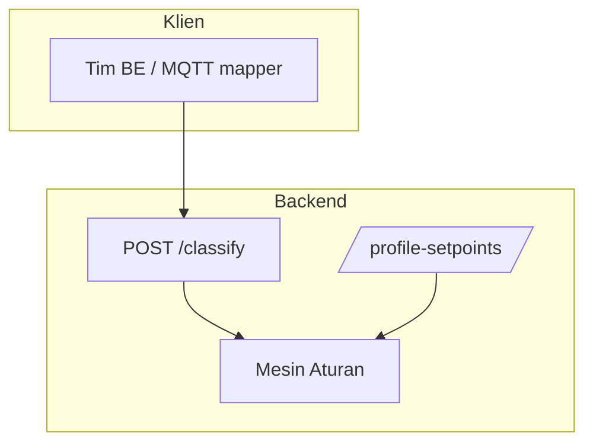

# 02 — Susunan Sistem

> Refactor 2026-10-19: backend Python dirampingkan menjadi **engine + API stateless**.
> Pipeline CSV/storage, CLI, dan DB ingest Python dihapus. Detail migrasi: `20`.

## Struktur Program Backend

```
backend/app/
  main.py                 # Titik masuk layanan web
  api_key.py              # Middleware X-API-Key
  api/
    classify.py           # POST /classify (kontrak stabil)
    profile_setpoints.py  # Ubah acuan tiap pompa
  classification/
    engine.py             # Aturan penilaian (orkestrator)
    engine_support.py     # T_A MA30/CMA_n, freq_eq_2dp, helper
    evaluator.py          # 8 aturan + panel/unbalance/voltage
    evidence.py           # Trailing 31 pasca-gap
    models.py             # Bentuk data masuk & keluar
    profiles.py           # Kapasitas per profil
    setpoints.py          # override > profil
    configuration_resolver.py
    service.py            # Factory get_engine()
    rules.json            # Batas tiap ukuran pompa + aturan tegangan
    pump_profiles.json    # Profil 500 / 3000 / 5000 lps
    profile_setpoints.json# Frekuensi / kecepatan / torsi per profil
```

## Struktur Tampilan (Frontend) — di luar scope refactor

```
frontend/src/app/
  api.ts                  # Panggil layanan (/api/*)
  replay.ts               # 16 sinyal file, tampung, gambar
  page.tsx                # Alih → /documents
  documents/page.tsx      # Penilaian kelompok + pindai + grafik file
  chat/page.tsx           # Chat asisten Dexmin (SSE)
  admin/page.tsx          # Ubah acuan tiap profil
```

> Endpoint lama `/documents`, `/normalization`, `/telemetry`, `/classification/*`
> sudah dihapus. Halaman `/documents` masih bisa dibuka, tetapi permintaan ke
> endpoint tersebut akan gagal sampai frontend disesuaikan pada tahap migrasi.

## Modul & Tanggung Jawab

| Modul | Peran | Batasan |
|-------|-------|---------|
| `classification` | Data → hasil (pembacaan terakhir; data hilang = tidak terdeteksi + catatan) | Tidak tahu tampilan/disk/DB |
| `api/classify` | Penghubung web single-shot | Tidak mengandung logika aturan |
| `api/profile_setpoints` | Baca/ubah acuan profil | Tidak mengandung logika aturan |
| `service.py` | Factory `get_engine()` | Tanpa CSV/FS/MySQL; tanpa duplikasi rumus |

## Diagram Komponen



Keterangan sederhana: JSON readings → aturan penilaian → jawaban JSON.
