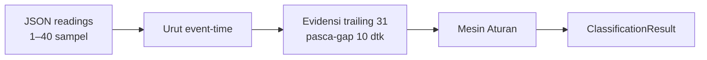

# 04 — Alir Data

> Refactor 2026-10-19: jalur file/CSV dihapus. Satu jalur tersisa: JSON readings
> → `/classify` → jawaban JSON. Detail migrasi: `20`.

## JSON → Penilaian Murni per-Sampel → Jawaban

- Penilaian murni: pembacaan terakhir + evidensi trailing 31 pasca-gap — tanpa window waktu.
- Waktu kejadian mengikuti `timestamp` sensor, bukan waktu terima; server yang mengurutkan.
- Data kosong (`null`) tidak diisi nol; gangguan terkait menjadi **tidak terdeteksi** disertai catatan.
- Jeda event-time > 10 detik memutus histori.
