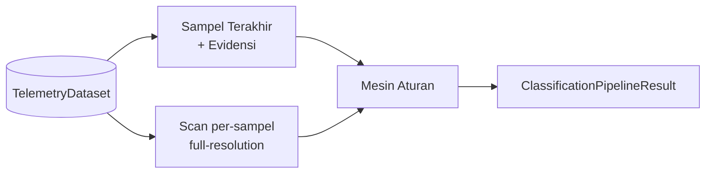

# 04 — Alir Data

Satu jalur penilaian: file → pindai → hasil, dengan satu aturan penilaian yang sama.

## KELOMPOK — File → Penilaian Murni per-Sampel → Jawaban

- Penilaian murni: pembacaan terakhir + evidensi trailing 31 pasca-gap — tanpa window waktu.
- Pemindaian: tiap sampel dinilai dengan evidensinya (gap event-time >10 dtk memutus histori), full-resolution tanpa stride; semua titik + titik gangguan disimpan.
