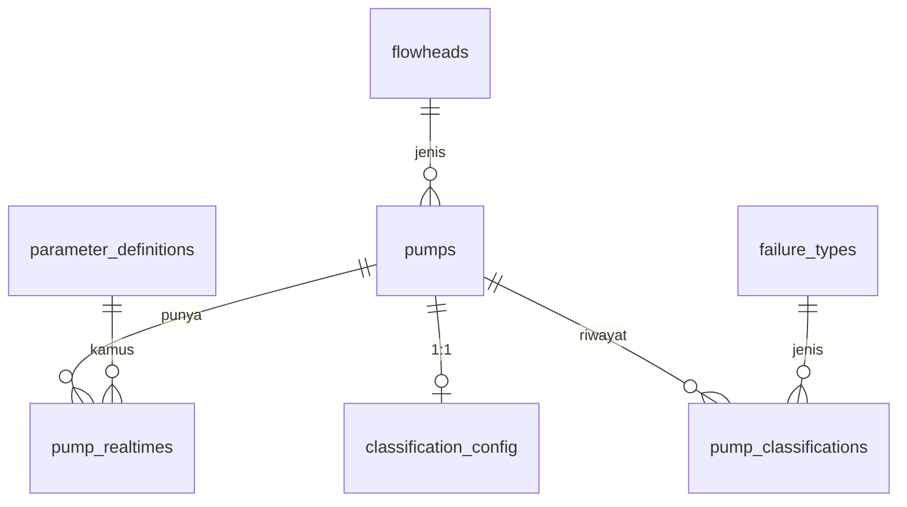

# 07 — Skema Penyimpanan (MySQL)

> 5R Rawat — sumber tunggal DDL: `App/service/schema/dexmin/dexmin.sql`. Dokumen ini ringkasan rancangan; bila berbeda, file SQL yang berlaku.

Skema basis data `dexmin`: 7 tabel, MySQL 8.x, `utf8mb4_unicode_ci`. Ditujukan untuk database baru/kosong atau audit rancangan — `CREATE TABLE IF NOT EXISTS` **tidak** memigrasikan struktur tabel lama.

Tujuan pembagian:

- **Sumber data pompa** — `flowheads`, `pumps`, `parameter_definitions`, `pump_realtimes`.
- **Pengaturan klasifikasi** — `classification_config`.
- **Jenis gangguan** — `failure_types`.
- **Riwayat gangguan** — `pump_classifications` (baru disiapkan strukturnya; pencatatan belum diaktifkan).

## Status Implementasi

| Lapisan | Status |
|---|---|
| Schema MySQL 7 tabel (`dexmin.sql`) | **Didefinisikan & dipertahankan** sebagai kontrak arsitektur DEXMIN |
| Ingestion DB Python (`app/ingest_db/`) | **Dihapus** pada refactor 2026-10-19 |
| Ingestion DB Node.js | **Akan dibangun** pada tahap migrasi (lihat `20-migrasi-nodejs.md`) |
| Pencatatan `pump_classifications` | **Belum diaktifkan** sampai pembahasan internal selesai |

Penghapusan ingestion Python tidak mengubah desain database. Database production
tidak disentuh oleh refactor ini.

## Diagram Relasi



## Ringkasan 7 Tabel

| No | Tabel | Fungsi | Kunci |
|----|-------|--------|-------|
| 1 | `flowheads` | Jenis / kapasitas pompa | PK `id` |
| 2 | `pumps` | Identitas pompa | PK `id`, FK `flowhead_id` |
| 3 | `parameter_definitions` | Kamus parameter telemetry | PK `id`, UNIQUE `key` |
| 4 | `pump_realtimes` | Pembacaan sensor | PK `id`, FK `pump_id`, FK `parameter_definition_id` |
| 5 | `classification_config` | Referensi + setpoint per pompa | PK/FK `pump_id` |
| 6 | `failure_types` | Master 8 jenis gangguan | PK `id`, UNIQUE `failure` |
| 7 | `pump_classifications` | Riwayat gangguan | PK `id`, FK `pump_id`, FK `type_failure` |

## Detail Tabel

### 1. `flowheads`

| Kolom | Tipe | Catatan |
|-------|------|---------|
| `id` | BIGINT UNSIGNED | PK, auto-increment |
| `type_flowhead` | VARCHAR(100) | Terindeks (`idx_flowheads_type`), tidak unik |

### 2. `pumps`

| Kolom | Tipe | Catatan |
|-------|------|---------|
| `id` | BIGINT UNSIGNED | PK, auto-increment |
| `flowhead_id` | BIGINT UNSIGNED NULL | FK → `flowheads.id`; satu pompa boleh belum punya flowhead |

### 3. `parameter_definitions`

| Kolom | Tipe | Catatan |
|-------|------|---------|
| `id` | BIGINT UNSIGNED | PK, auto-increment |
| `key` | VARCHAR(100) | UNIQUE (`uq_parameter_definitions_key`), mis. `motor_current`, `output_frequency` |

### 4. `pump_realtimes`

| Kolom | Tipe | Catatan |
|-------|------|---------|
| `id` | BIGINT UNSIGNED | PK, auto-increment |
| `pump_id` | BIGINT UNSIGNED | FK → `pumps.id` (CASCADE) |
| `parameter_definition_id` | BIGINT UNSIGNED | FK → `parameter_definitions.id` (RESTRICT) |
| `value` | VARCHAR(255) NULL | NULL = data tidak tersedia, **bukan** nol. Konversi numerik di worker |
| `updated_at` | DATETIME | DEFAULT `CURRENT_TIMESTAMP` |

Bila ada lebih dari satu baris per pompa/parameter, pembaca memilih baris terbaru berdasarkan `updated_at` lalu `id` (index `idx_realtime_latest`).

### 5. `classification_config`

Satu pompa maksimum satu konfigurasi (`pump_id` sebagai PK). NULL pada kolom berarti fallback ke profil bawaan engine — **bukan** ke kolom reference di `flowheads`.

| Kolom | Tipe | Catatan |
|-------|------|---------|
| `pump_id` | BIGINT UNSIGNED | PK, FK → `pumps.id` (CASCADE) |
| `operating_freq_hz` | DECIMAL(8,2) NULL | Setpoint frekuensi (Hz) |
| `operating_rpm` | DECIMAL(8,2) NULL | Setpoint kecepatan (RPM) |
| `operating_torque` | DECIMAL(8,2) NULL | Setpoint torsi, satuan persen (%) |
| `ref_power_kw` | DECIMAL(10,3) NULL | Referensi daya (kW) |
| `ref_current_a` | DECIMAL(10,2) NULL | Referensi arus (A) |
| `updated_at` | TIMESTAMP | DEFAULT `CURRENT_TIMESTAMP`, ON UPDATE `CURRENT_TIMESTAMP` |

Referensi daya/arus **hanya** ada di tabel ini. Rumus klasifikasi berada di aplikasi, bukan di database.

### 6. `failure_types`

| Kolom | Tipe | Catatan |
|-------|------|---------|
| `id` | BIGINT UNSIGNED | PK, auto-increment |
| `failure` | VARCHAR(100) | UNIQUE (`uq_failure_types_failure`); identitas kode untuk Classification Engine |
| `name` | VARCHAR(150) | Label tampilan aplikasi |

Seed 8 jenis gangguan (idempotent, aman dijalankan ulang):

| id | failure | name |
|----|---------|------|
| 1 | `pompa_tersangkut_sampah` | Pompa Tersangkut Sampah |
| 2 | `turbulensi` | Turbulensi |
| 3 | `banyak_sampah` | Banyak Sampah |
| 4 | `unbalance` | Unbalance Arus |
| 5 | `undervoltage` | Undervoltage |
| 6 | `overvoltage` | Overvoltage |
| 7 | `dry_run` | Dry Run |
| 8 | `panel_overheat` | Panel Overheat |

Kolom `failure` dipakai Classification Engine; `name` untuk tampilan. Kondisi **Normal tidak** dimasukkan karena bukan jenis gangguan.

### 7. `pump_classifications`

Struktur riwayat gangguan. `ended_at NULL` berarti gangguan masih berlangsung.

| Kolom | Tipe | Catatan |
|-------|------|---------|
| `id` | BIGINT UNSIGNED | PK, auto-increment |
| `pump_id` | BIGINT UNSIGNED | FK → `pumps.id` (CASCADE) |
| `type_failure` | BIGINT UNSIGNED | FK → `failure_types.id` (RESTRICT) |
| `started_at` | DATETIME | Mulai gangguan |
| `ended_at` | DATETIME NULL | NULL = masih berlangsung |
| `trigger_count` | INT UNSIGNED | DEFAULT 1 |

Mekanisme pencatatan gangguan **belum diaktifkan** sampai pembahasan internal selesai.

## Relasi (6 Foreign Key)

| Tabel | FK | Referensi | ON UPDATE / ON DELETE |
|-------|----|-----------|------------------------|
| `pumps` | `fk_pumps_flowhead` | `flowheads.id` | CASCADE / RESTRICT |
| `pump_realtimes` | `fk_realtime_pump` | `pumps.id` | CASCADE / CASCADE |
| `pump_realtimes` | `fk_realtime_parameter` | `parameter_definitions.id` | CASCADE / RESTRICT |
| `classification_config` | `fk_classification_config_pump` | `pumps.id` | CASCADE / CASCADE |
| `pump_classifications` | `fk_pump_classifications_pump` | `pumps.id` | CASCADE / CASCADE |
| `pump_classifications` | `fk_pump_classifications_failure` | `failure_types.id` | CASCADE / RESTRICT |

## Keputusan Desain

- Tidak menggunakan `raw_classifications` maupun `failure_categories`.
- Referensi daya/arus hanya ada pada `classification_config`.
- `operating_torque` menggunakan satuan persen (%).
- Normal adalah kondisi engine, **bukan** jenis gangguan di `failure_types`.
- Rumus klasifikasi tetap di aplikasi, bukan di database.
- Tidak ada trigger atau debounce dalam file SQL.

## Contoh Query

Ambil nilai terbaru per parameter untuk satu pompa (memanfaatkan `idx_realtime_latest`):

```sql
SELECT `key`, value, updated_at FROM (
    SELECT pd.`key`, pr.value, pr.updated_at,
           ROW_NUMBER() OVER (
               PARTITION BY pr.parameter_definition_id
               ORDER BY pr.updated_at DESC, pr.id DESC
           ) AS rn
    FROM pump_realtimes pr
    JOIN parameter_definitions pd ON pd.id = pr.parameter_definition_id
    WHERE pr.pump_id = ?
) x
WHERE rn = 1;
```

Tulis pembacaan sensor:

```sql
INSERT INTO pump_realtimes (pump_id, parameter_definition_id, value, updated_at)
VALUES (?, ?, ?, NOW());
```

Upsert setpoint/referensi pompa (PK `pump_id` mencegah duplikasi):

```sql
INSERT INTO classification_config
    (pump_id, operating_freq_hz, operating_rpm, operating_torque, ref_power_kw, ref_current_a)
VALUES (?, ?, ?, ?, ?, ?)
ON DUPLICATE KEY UPDATE
    operating_freq_hz = VALUES(operating_freq_hz),
    operating_rpm     = VALUES(operating_rpm),
    operating_torque  = VALUES(operating_torque),
    ref_power_kw      = VALUES(ref_power_kw),
    ref_current_a     = VALUES(ref_current_a);
```

Seed `failure_types` (bentuk idempotent, sama seperti di `dexmin.sql`):

```sql
INSERT INTO failure_types (`failure`, name) VALUES
    ('pompa_tersangkut_sampah', 'Pompa Tersangkut Sampah'),
    -- ... 7 baris lain ...
    ('panel_overheat', 'Panel Overheat')
ON DUPLICATE KEY UPDATE name = VALUES(name);
```

Buka dan tutup riwayat gangguan (untuk saat mekanisme diaktifkan):

```sql
INSERT INTO pump_classifications (pump_id, type_failure, started_at, trigger_count)
SELECT ?, ft.id, ?, 1 FROM failure_types ft WHERE ft.failure = ?;

UPDATE pump_classifications
SET ended_at = ?
WHERE id = ? AND ended_at IS NULL;
```

Riwayat gangguan aktif per pompa:

```sql
SELECT pc.id, ft.failure, ft.name, pc.started_at, pc.trigger_count
FROM pump_classifications pc
JOIN failure_types ft ON ft.id = pc.type_failure
WHERE pc.pump_id = ? AND pc.ended_at IS NULL;
```

## Status Validasi

Tervalidasi pada database development (container `db-mysql`, MySQL 8.0.46): 7 tabel, 8 baris `failure_types`, 6 foreign key, dan file dapat dijalankan ulang tanpa kesalahan.

## Lihat Juga

- `13-operations.md` — konfigurasi koneksi (`CLASSIFICATION_DB_*`, untuk tahap migrasi).
- `06-classification.md` — aturan klasifikasi yang memakai `failure_types.failure`.
- `20-migrasi-nodejs.md` — rencana ingestion Node.js.
- Sumber DDL: `App/service/schema/dexmin/dexmin.sql`.
