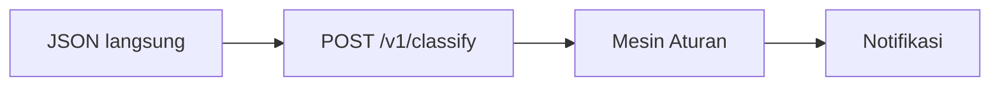

# 19 — Jalur Masuk dan Peran Klasifikasi (Bahasa Sederhana)

> 5R: ringkas, rapi, bersih, terawat, rajin. Dokumen ini menjelaskan jalur masuk dulu, peran klasifikasi nanti. Angka batas lengkap tetap di `06`, kontrak BE tetap di `18`.

## Ringkasan

Klasifikasi mengubah data sensor pompa menjadi bunyi/notifikasi gangguan. Bukan AI, bukan vonis menang-kalah, tidak ada prioritas bahaya.

Ada 9 hasil: `pompa_tersangkut_sampah`, `turbulensi`, `banyak_sampah`, `unbalance`, `undervoltage`, `overvoltage`, `dry_run`, `panel_overheat`, `normal` (sehat).

## 1. Jalur masuk — 1 pintu, 1 mesin

> Refactor 2026-10-19: jalur file/CSV (unggah → telemetry → run/scan) **dihapus**.
> Yang tersisa hanya jalur JSON langsung. Detail: `20-migrasi-nodejs.md`.



| Jalur | Butuh CSV? | Butuh `profile_id`? | Keterangan |
|---|---|---|---|
| `POST /v1/classify` | Tidak | Ya + `namespace` wajib (ID site) | Stateless, tanpa simpan file. Untuk tim BE/MQTT. Max 40 readings. |

Aturan potong (berlaku semua jalur):

- Dipakai **waktu kejadian** dari sensor, bukan waktu terima. Urutan bebas, server yang mengurutkan.
- Ambil **maks 31 data terakhir**. Berhenti kalau ada **jeda > 10 detik**.
- Data kosong dibiarkan kosong, tidak diisi `0`. `timestamp` di `v1` wajib ber-zona waktu.
- MQTT/live di dalam service ini sudah dihapus (2026-10-10). Tim BE baca MQTT di luar, lalu kirim ke `v1/classify`.

Lihat: `01` (gambaran umum), `04` (alir data), `18` (kontrak BE).

## 2. Cara mesin menilai — 5 langkah

1. Urutkan data menurut waktu kejadian.
2. Potong bukti 31 pasca-gap 10 detik.
3. Cari tier aturan dari kapasitas pompa + setpoint frekuensi (`override > profil`).
4. Cek tiap gangguan: terdeteksi / tidak terdeteksi. Data hilang = tidak terdeteksi + catatan di `limitations`.
5. Tidak ada yang cocok → `normal`. Ada yang cocok → semua masuk `matched_rules`.

Semua pola langsung diputuskan 1x (`count_trigger: 1`), tanpa menunggu bukti berulang.

## 3. Peran di hilir — seperti bel pintu

- Semua yang terdeteksi sama pentingnya, seperti beberapa bel bunyi bersamaan.
- `trouble_type` hanya **salah satu bunyi yang aktif** — yang dicek duluan secara teknis (tier → panel → unbalance → voltage). **Bukan juara, bukan prioritas bahaya.**
- Hasil **tidak disimpan** di DB, tidak ada publish MQTT, bunyi suara, atau kirim otomatis ke Dexmin/LLM. Hanya jawaban JSON di memori. Refresh = pindai ulang. Chat dan klasifikasi tetap pisah.
- Chat `/chat` pakai `language` (`lapangan|en`), bukan `profile_id` (klasifikasi tetap `profile_id`).
- Frontend `/documents`: buang `normal`, pakai `trouble_type` untuk kartu angka, area warna di grafik, tabel + tombol Zoom, dan toast "Selesai: X dari Y titik". `matched_rules` + `snapshot` + `limitations` dikirim backend tapi belum ditampilkan (blok "Indikasi Tambahan" saat ini mati). **Catatan refactor 2026-10-19:** endpoint yang dipakai halaman ini (`/documents`, `/telemetry`, `/classification/*`) sudah dihapus; lihat `11` dan `20`.
- Tim BE: baca `classification.trouble_type` untuk notif sendiri, simpan `rules_version` untuk sinkron ambang. Jangan hardcode `360/410/60` di BE.

## 4. Contoh

Input (`v1`):

```json
{"profile_id": "5000_lps", "namespace": "96", "readings": [{"timestamp": "2026-06-12T14:33:56+07:00", "output_frequency": 40.0, "input_voltage": 355.0}]}
```

Output: `trouble_type: undervoltage` karena `355 < 360`. Di frontend: kartu `UNDERVOLTAGE`, area warna di grafik tegangan, baris tabel + Zoom, toast selesai.

Detail aturan tiap gangguan: lihat `06`. Istilah laporan: lihat `14`.
